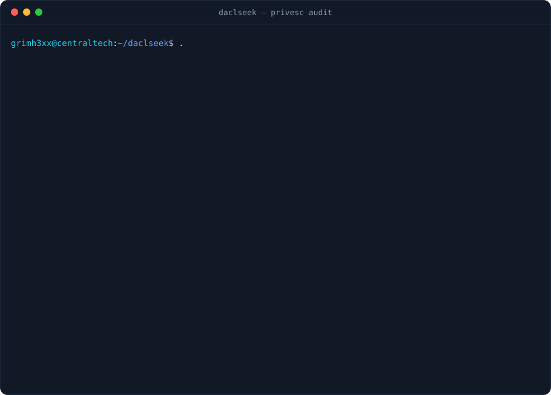

[](https://github.com/grimh3xx/mycroft/actions)
[](LICENSE)


**A local Windows privilege-escalation *misconfiguration* enumerator, in Rust.** It is the
spiritual successor to the archived PowerShell [Sherlock](https://github.com/rasta-mouse/Sherlock)
and C# [Watson](https://github.com/rasta-mouse/Watson) — but it takes the opposite approach.
Those shipped a hand-maintained **CVE → fixing-KB** table and checked the patch level, so they
rotted the moment their authors stopped updating them (both archived in 2021, blind on modern
builds). mycroft instead enumerates **misconfigurations that are exploitable regardless of
patch level** — the class of findings that never goes stale. Strictly **read-only**: it
inspects the host and reports, with remediation guidance. It never exploits, modifies,
downloads or exfiltrates anything.

<p align="center"></p>

> ⚠️ For **authorised** security assessments, hardening reviews and defensive baselining only.
> Run it solely on systems you own or are explicitly permitted to test.

## What it checks

| Check | What it reports |
|---|---|
| **Token privileges** (`PRIV`) | Dangerous privileges held by the current token — `SeImpersonate`, `SeDebug`, `SeBackup`, `SeRestore`, `SeTakeOwnership`, `SeLoadDriver`, `SeTcb`, … — with the risk each one carries. A privilege the token *holds* is reported even when currently disabled. |
| **Services** (`SVC`) | Writable service registry keys (rewrite `ImagePath`), unquoted service paths with a writable segment, writable service binaries, and writable service directories (DLL side-loading / binary replacement). |
| **Scheduled tasks** (`TASK`) | Tasks whose action binary — or its directory — is writable by the current user, read straight from the on-disk task XML. |
| **AlwaysInstallElevated** (`AIE`) | The installer policy that applies MSI packages with elevated rights for standard users. |
| **Autoruns** (`RUN`) | `Run` / `RunOnce` entries whose target binary or directory is writable by the current user. |
| **PATH** (`PATH`) | User-writable directories on the system `PATH` — a name-based resolution exposure. |
| **UAC** (`UAC`) | Weak UAC configuration: disabled, silent admin elevation, or no secure desktop. |
| **Credentials** (`CRED`) | Credential-exposure surfaces: registry autologon password, leftover unattend/sysprep answer files, and security-hive backups. |

Findings are ranked worst-first, tagged `INFO` / `LOW` / `MEDIUM` / `HIGH` / `CRITICAL`, and
each carries the concrete evidence plus a remediation step.

## How the write-access checks work

The "is X writable by me?" checks are **not heuristics**. For each target, mycroft:

1. reads the object's security descriptor (`GetNamedSecurityInfoW`),
2. duplicates the current process token to an impersonation token,
3. runs a real kernel `AccessCheck` for write / modify / delete / take-ownership.

So group membership, inheritance and explicit deny-ACEs are all honoured — a positive result
means the current context genuinely has that access, not that an ACL merely looks loose.

## Build

Native build on Windows (needs the [Rust toolchain](https://rustup.rs)):

```bash
cargo build --release
```

Cross-compile from Linux / WSL:

```bash
rustup target add x86_64-pc-windows-gnu
cargo build --release --target x86_64-pc-windows-gnu
```

Output is a single **~300 KB static binary** with **no .NET runtime required** on the target —
a direct win over Watson.

## Usage

```
mycroft [OPTIONS]

OPTIONS:
    --json            Emit findings as JSON (for pipelines / triage)
    --no-color        Disable ANSI colours
    --only <check>    Run one check: privileges, services, tasks, installer,
                      autoruns, path, uac, credentials
    -h, --help
    -V, --version
```

Run it as the user whose context you want to assess — most findings are privilege-relative; a
path writable by a low-privileged user is the interesting case.

```bash
mycroft                  # full console report
mycroft --json           # machine-readable
mycroft --only services  # just the service checks
```

## Design

- **No external data file, no network** — findings come from live host state, so there is
  nothing to keep up to date.
- Adding a check is one file in `src/checks/` plus one line in `src/main.rs`.
- Natural next modules: DLL-search-order gaps in application directories, and an optional
  WES-NG-style offline KB-diff module if missing-patch coverage is also wanted.

The animated demo above is regenerated with `python3 tools/gen_demo.py`.

## License

MIT
